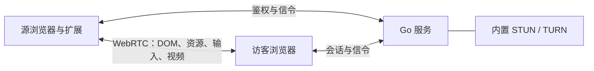

# 架构与同步机制

[返回 README](../README.md)

## 组件

源网页继续在所有者的真实浏览器中执行 JavaScript，使用原有登录状态。扩展采集可渲染的 DOM 和必要画面，将访客的操作传回源标签页。访客不独立运行原网站。

Go 服务管理配对、分享和信令，并提供内置 TURN 中继。WebRTC 不可用时，WebSocket/HTTP 继续提供应急同步和控制。

## WebRTC 与画面采集

DOM、本地表单输入与图片/字体优先走 WebRTC DataChannel；状态、输入和资源分开，16 KiB 分片、可靠有序传输，限制缓冲区和接收对象大小。仅在可见复杂区域需要时启动视频轨道。CDP 和原生 tabCapture 视频来源均会在源端将区域拼入较小画布后编码，访客按区域映射还原；部分越界裁剪到视口与滚动容器，遮挡区域在访客端遮罩处理；每个共享标签页只维护一份裁剪画布，多名访客共用。没有音频轨道。

Chrome MV3 service worker 不提供 RTCPeerConnection，扩展在 offscreen document 中维护连接。手动共享当前标签页时尝试原生 `tabCapture`；Chrome 需要所有者先点击扩展，流 ID 也只能短时间内使用。自动重开的网址标签页及原生捕获不可用时，使用 CDP `Page.startScreencast` 连续获取共享标签页画面，送到 canvas 视频轨道再由 WebRTC 编码。没有合成帧的后台标签页使用自适应截图补充视频源：变化时目标 30 fps，不变时降低采样并跳过重复画面；浏览器自身限制后台页面脚本/动画时，无法强迫原网站按 30 fps 绘制。此路径在本机有 JPEG 解码及再次编码开销；JPEG 帧不经 Go 服务转发。它无法绕过 Chrome 捕获授权，扩展调试标识保持可见。关闭/暂停会话时释放视频；没有复杂区域的 DOM 模式停止视频发送和画布绘制。已授权的原生轨道暂时禁用并保留，以便再次需要局部视频时复用授权。

优先直连，两端用 ICE/STUN 协商；内置 TURN 启用时也提供 STUN。默认额外 STUN 为 `stun:stun.l.google.com:19302`，可通过 `-stun` 改成自有服务或设为空（仅用内置 STUN）。直连失败时使用 TURN 中继，DOM DataChannel 和视频都适用，WebRTC 保持端到端加密；Go 的 TURN 不解密数据。初始化协商阶段或 WebRTC 不可用时，WebSocket/HTTP 应急传输也会经过 Go。页面显示当前 `P2P 直连`、`TURN 中继` 或 `WebSocket 兜底`。连接失败后每 5 秒重试，服务重新签发凭据给两端，避免无人值守运行超过 24 小时后使用过期凭据。

TURN 部署、鉴权和 TLS 参数见 [部署文档](deployment.md)。

## DOM 差异与资源传输

源标签页的隔离脚本用 `MutationObserver` 收集变化。相同节点的多次变化合并，默认最多每 200ms 发送一批。只计算受影响节点的样式，不每批扫描整棵 DOM；class/style 变化需要更新受影响子树。初次连接、导航和明确的重新同步将完整结构分成浅层节点批次发送，每次最多处理 300 节点，约 24ms 时间片及 160KB 内容预算；访客会将晚到的子节点挂回父节点。默认样式抽取为共享 CSS，节点只携带与基准不同的属性。支持白名单内的原生 SVG 图标。首次构建期间约每 55ms 继续一批，正常变化仍合并至最多 5Hz；新访客通过 DataChannel 从源端合并缓存接收初始化快照；后续只收差异，不重新扫描整页，也不给已有访客重发全量。应急 WebSocket 通道使用服务端缓存。

常规 DOM 增量的软预算为每标签页 128 KiB/s。超过预算的批次会延迟下次同步，期间继续合并变化；初始结构不计入此持续预算。前台 WebRTC 视频目标最高 30 fps、4 Mbps，应用按访客显示尺寸主动缩放，并参考 RTT、可用带宽、丢包及编码耗时限制码率和帧率；浏览器自身的拥塞控制继续生效。后台访客降到最高 2 fps、150 kbps，回前台自动恢复；所有访客都在后台时，CDP 和原生来源也降低采集/绘制频率，DOM 更新适当降频。仅 WebRTC 未建立或失效时的应急截图最多 2 帧/s，软预算 64 KiB/s。预算是调度上限，单个批次、首次结构以及 WebSocket/JSON 开销可能产生短时突发。多个不同分享链接绑定同一标签页时，当前实现会分别转发，流量随链接数量增加。

图片、背景图和实际使用且已加载的字体通过源浏览器的资源缓存读取，必要时仅对已加载的 URL 使用源浏览器网络上下文补读，支持跨域和需登录的资源。资源优先通过独立的可靠 DataChannel 分片发送，DOM 增量中只携带短资源标识，访客验证 SHA-256 后生成本地 Blob URL。WebRTC 失效时才上传 Go 中继，服务器按 SHA-256 去重。资源使用独立 256 KiB/s 软预算，只按实际向各接收者发送的字节扣预算，缓存命中不等待。单个对象可短时突发，预算等待最长 30 秒；单资源上限 8 MiB、会话最多 256 项 / 32 MiB、服务器全局 128 MiB，源端和访客端也有 32 MiB 资源缓存上限。导航、最后一名访客离开、浏览器断开或撤销时清理服务器资源，资源不会落盘。读取失败的图片或无子节点元素可局部画面补偿；资源失败不会把整页切成视频。

静止页面不发送 DOM 数据，连接保活每 20 秒一次。CSS 动画使用可读取的 keyframes 在访客端本地播放，不采样每帧动画样式。JavaScript 动画产生的 DOM 变化按批次合并，可能降低动画流畅度。原页面复杂度、资源大小和网络延迟都会影响体验；这不是对所有网站都保持原生表现的保证。

## 渲染、压缩和背压

资源到达后只更新引用它的节点和 CSS 规则，同一批完成事件合并处理；不会重写所有表单和样式。资源请求去重，SHA-256 在源端复用，向多名访客传输时合并 Base64 转换和解码工作。

状态和资源使用独立通道，资源可能先于压缩 DOM 到达。访客保留最多 4 个待显示文档的资源，切换文档后清理已离开的版本，拒绝其迟到资源；暂存仍计入 32 MiB 缓存上限，避免导航时误丢图片和字体。

大于 8 KiB 且确实能缩小的状态消息使用 gzip；小输入消息直接发送，PNG/JPEG/字体等资源保持原始字节。压缩位于有序发送队列内，接收端按顺序解压，并限制解压后的大小。应急 WebSocket 可协商无上下文复用的压缩。服务端与扩展按当前版本一起更新。

输入按标签页排队，最多积压 256 个待执行操作。相邻待执行的鼠标移动可合并，按键、点击和导航保持顺序；超额访客断开后重新同步，不拖住其他标签页。网页提示的回答可直接解除源网页的阻塞。

视频区域的光标及可读取的文字选区作为少量 DOM 元数据同步；本地输入代理用 CSS 坐标定位，源端只计算光标几何，不为定位复制输入框内容。HTTP 文档响应通过 Fetch 响应阶段识别附件，以 IO 流读取实际 GET/POST 响应，避免重新请求。页面 Blob 在源页读取，脚本生成的脱离 DOM 的下载链接通过可恢复的 anchor click hook 观测。文件以 256 KiB 分块、逐块 SHA-256 校验，优先独立资源 DataChannel；中继只向该操作的访客转发，不缓存文件到磁盘。下载固定使用开始时的传输路径，中断后不混合乱序续传。来源浏览器记录请求开始时的操作发起者，文件名和 MIME 不包含 Cookie、请求头或本地路径。

DataChannel 采用缓冲区低水位事件恢复发送，每连接最多积压 24 MiB，同一模块实例内总计 64 MiB；长时间无法排空时断开并恢复同步。Go WebSocket 每连接最多积压 128 条 / 8 MiB，全局逻辑队列上限 64 MiB。广播共享已编码消息，连接关闭时释放预算。上述字节限制不是整个进程的内存上限；DOM、资源、解压缓冲、浏览器及系统开销另计。

会话请求体读取和 HTTP 响应均在全局状态锁外进行。持久化写入单独串行，成功落盘后才提交创建或撤销状态，失败不会改变当前访问权。

Go 的 DOM 缓存默认全局 64 MiB，单文档 6 MiB，按序列化节点、CSS 与元数据计账。增量先校验预算再原子提交；清空、撤销和最后访客离开时归还预算。全部访客转为 WebRTC 或最后一名应急访客离开后，清除重复的服务端 DOM 和资源缓存；后续应急恢复从源浏览器获取快照及图片/字体。传输切换期间迟到的 HTTP 上传返回 202 且不留缓存，源端不会保留错误的已送达标记。容量不足时只断开当前会话的应急访客，由现有重连流程重新获取状态；其他会话和直接 WebRTC 访客继续运行。此预算不是 Go 堆内存上限，排队快照和解压等开销另计。

内置 TURN 默认共享 50 Mbps 的双向中继载荷预算，令牌桶允许最多 256 KiB 短时突发。超额数据报丢弃，由 RTP/SCTP 拥塞控制和可靠重传响应，不新增等待队列，也不阻塞 STUN/TURN 鉴权和保活。预算覆盖所有中继分配，不是每名访客各 50 Mbps；包含内部中继路径，不等于公网账单带宽或月流量配额。管理员可调整默认值，普通部署仍只填写域名。

源端 DOM 上限为 30,000 节点、约 5.5MB 序列化节点；达到上限保留已同步 DOM，不转为整页视频，未同步部分可能缺失。采集超时会重新分批同步。源浏览器提供 CDP 历史条目 ID，访客将其映射到自身 history.state 与 hash；浏览器 popstate 发送受限的历史跳转，远程广播同步时避免回送相同导航。
